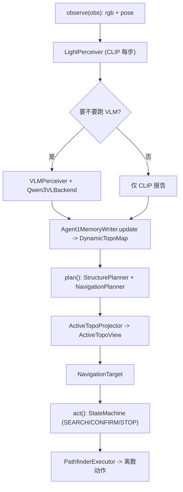

# ConfTopo 代码库完整指南

本文件系统说明 **当前在用** 的 `goat_agent_1.py` 栈（`ConfTopoGOATAgent`）：整体架构、
单步生命周期、以及每个模块 / 文件的作用与关键类。文末列出**历史遗留 / 非当前路径**的文件，
避免踩到旧代码。

> 入口：[scripts/run_goat_agent1_smoke_v2.py](../../scripts/run_goat_agent1_smoke_v2.py)
> → `ConfTopoGOATAgent`（[conftopo/agents/goat_agent_1.py](../agents/goat_agent_1.py)）。

---

## 1. 整体架构

ConfTopo 是一个**拓扑地图 + VLM 感知 + 离散动作**的零样本目标导航智能体。核心思想：

- **双层拓扑地图**（`DynamicTopoMap`）：
  - **Navigation Layer（导航层）**：waypoint（走过的位姿）、frontier（探索边界），负责"怎么走"。
  - **Structure Layer（结构层）**：object / room / landmark / portal 语义节点，负责"目标在哪"。
  - **Cross-Layer Links**：把语义节点绑定到锚点 waypoint（object 挂在某个观测 waypoint 上）。
- **置信度驱动**：每个节点区分 R（任务相关性）/ C（地图置信度）/ A（可达性），规划时融合成一个分数。
- **ActiveTopo 视图**：按当前 goal 把持久拓扑投影成一个"活跃子图"，节点有 ACTIVE / VERIFY /
  FOLDED / SUPPRESSED 四种生命周期状态。
- **三态控制**：SEARCH → CONFIRM → STOP。

**单步生命周期**（`GOATAgent` 的三个公有方法）：

1. `observe(obs)` — 收 rgb + 位姿；跑 CLIP（每步）；按触发策略决定是否跑 VLM；把感知结果写进拓扑地图。
2. `plan()` — 先更新 recovery / 重建 ActiveTopoView；结构规划器产出候选意图，导航规划器选出一个 `NavigationTarget`。
3. `act(target)` — 状态机根据 VLM 报告在 SEARCH/CONFIRM/STOP 间流转，产出离散动作（navigate / move_forward / turn / stop …）。

---

## 2. 当前在用的文件一览

| 层 | 文件 | 作用（一句话） |
| --- | --- | --- |
| 入口 | `scripts/run_goat_agent1_smoke_v2.py` | smoke / 评测脚本，构建 agent、驱动 habitat 闭环、出 trace |
| 配置 | [config.py](../config.py) | 全局配置（Memory / Perception / Planning） |
| 智能体 | [agents/base_agent.py](../agents/base_agent.py) | 抽象基类 `ConfTopoBaseAgent` |
| 智能体 | [agents/goat_agent_1.py](../agents/goat_agent_1.py) | **主编排器** `GOATAgent`（= `ConfTopoGOATAgent`） |
| 智能体 | [agents/goat_agent1_types.py](../agents/goat_agent1_types.py) | 共享数据结构 / 枚举 / ActiveTopo 类型 |
| 智能体 | [agents/goat_agent1_memory.py](../agents/goat_agent1_memory.py) | 记忆写入策略：感知→拓扑地图 |
| 智能体 | [agents/goat_agent1_planner.py](../agents/goat_agent1_planner.py) | 结构 + 导航两级规划器、R/C/A 打分 |
| 智能体 | [agents/goat_agent1_active_topo.py](../agents/goat_agent1_active_topo.py) | `ActiveTopoProjector`：持久图→活跃视图 |
| 智能体 | [agents/goat_agent1_control.py](../agents/goat_agent1_control.py) | 三态状态机 + STOP 校验 |
| 核心 | [core/dynamic_topo_map.py](../core/dynamic_topo_map.py) | 双层拓扑地图 + 跨层链接 |
| 核心 | [core/object_memory_pool.py](../core/object_memory_pool.py) | object 节点的 upsert / 融合 / 匹配 |
| 核心 | [core/confidence.py](../core/confidence.py) | 置信度模型、记忆状态机、属性/关系打分 |
| 核心 | [core/instruction_graph.py](../core/instruction_graph.py) | `GoalNode` / `InstructionGraph` 目标表示 |
| 核心 | [core/hypothesis_pool.py](../core/hypothesis_pool.py) | 弱证据假设池（提升前的暂存） |
| 核心 | [core/landmark_roles.py](../core/landmark_roles.py) | 结构标签判定、object→landmark 提升规则 |
| 核心 | [core/region_rooms.py](../core/region_rooms.py) | waypoint 聚类成房间区域 |
| 核心 | [core/goal_graph_preprocess.py](../core/goal_graph_preprocess.py) | 离线：GOAT/SOON 任务→GoalNode、图像 goal 嵌入 |
| 核心 | [core/gt_room_regions.py](../core/gt_room_regions.py) | 评测用 GT 房间区域 |
| 感知 | [perception/light_perceiver.py](../perception/light_perceiver.py) | 轻量 CLIP 感知（每步：房间/goal 相似度） |
| 感知 | [perception/clip_runtime.py](../perception/clip_runtime.py) | CLIP 编码器封装（图/文/按模态） |
| 感知 | [perception/vlm_backend.py](../perception/vlm_backend.py) | VLM 后端（`Qwen3VLBackend` / Fake） |
| 感知 | [perception/vlm_prompts.py](../perception/vlm_prompts.py) | VLM 提示词与 JSON 解析 |
| 感知 | [perception/vlm_perceiver.py](../perception/vlm_perceiver.py) | VLM 感知器：调后端→`PerceptionReport` |
| 感知 | [perception/perception_report.py](../perception/perception_report.py) | 统一感知输出 `PerceptionReport` |
| 感知 | [perception/perception_trigger.py](../perception/perception_trigger.py) | 何时触发重感知（VLM） |
| 感知 | [perception/heavy_perceiver.py](../perception/heavy_perceiver.py) | `ObjectObservation` + GroundingDINO 后端 |
| 感知 | [perception/clip_gdino_report_builder.py](../perception/clip_gdino_report_builder.py) | CLIP+GDINO 后端的报告构建（非 VLM 路径） |
| 导航 | [navigation/pathfinder_executor.py](../navigation/pathfinder_executor.py) | 目标位置→离散动作、可达性探测、全局图规划 |

---

## 3. 配置：`config.py`

三个 dataclass 聚合在 `ConfTopoConfig` 里：

- **`MemoryConfig`** — 记忆/地图参数（合并半径、剪枝阈值、置信度衰减等）。
- **`PerceptionConfig`** — 感知后端与参数：
  - `backend`（`clip_groundingdino` / `vlm`）、`vlm_api_base` / `vlm_model` / `vlm_timeout`
  - `vlm_temperature` / `vlm_seed`（`--deterministic` 会置 0 / 固定种子）
  - `room_labels`（CLIP 房间标签集）
  - **STOP CLIP 闸门**：`stop_clip_gate_enabled` / `stop_clip_min_image`(0.55) / `stop_clip_min_text`(0.18)
- **`PlanningConfig`** — 规划权重与阈值。

---

## 4. 核心层 `core/`

### `dynamic_topo_map.py` — 双层拓扑地图（系统的地图心脏）
- `NodeType`：`WAYPOINT` / `WAYPOINT_FRONTIER` / `WAYPOINT_CANDIDATE` / `WAYPOINT_APPROACH` /
  `OBJECT` / `ROOM` / `LANDMARK` / `PORTAL`。
- `EdgeType`：`NAVIGABLE` / 跨层绑定等。
- `SemanticNode`：统一节点（`node_id / node_type / position / embedding / confidence / label / attributes`）。
- `StructureLayer` / `NavigationLayer`：分别管语义节点、导航节点（含 waypoint 增量、frontier 生成）。
- `CrossLayerLinks`：object↔anchor waypoint、room↔object 等绑定关系。
- `DynamicTopoMap`：对外总接口 —— 加/查节点、`navigation_target_for_structure_node`、
  `consume_node`、置信度重算与剪枝（`compute_semantic_confidence` + 分级衰减）。

### `object_memory_pool.py` — object 节点的生命周期
- `ObjectMemoryPool.upsert(...)`：新检测要么新建 object 节点，要么与已有节点**融合**
  （按 bbox IoU / 朝向 / 嵌入相似 / 距离匹配），维护 `multi_view_count`、`last_bbox`、
  `best_approach_position` 等。是"同一物体多次观测归并"的地方，也是 FOV 置信度累积 attrs 的载体。

### `confidence.py` — 置信度与语义打分
- `ConfidenceFactors` + `compute_semantic_confidence` / `compute_topo_confidence`：由检测分、
  多视角数、任务相关性、房间先验、冗余/冲突惩罚、staleness 综合出节点置信度。
- `update_on_observation`：一致→升、不一致→降。
- `update_memory_state`：`candidate/semantic_confirmed/preserved/rejected/expired` 状态机
  （强负证据或置信度崩溃→rejected/expired→被 consume）。
- `AttributeMatcher` / `RelationScorer`：属性、空间关系相关性打分（Phase G 多模态相关性用到）。

### `instruction_graph.py` — 目标表示
- `GoalNode`：单个子目标（`target_object / goal_type∈{category,description,image} / attributes /
  room_prior / landmarks / relations / target_embedding`）。
- `InstructionGraph`：多子目标序列容器。`normalize_goal_node` 做 schema 清洗。

### `hypothesis_pool.py` — 弱证据暂存
- `Hypothesis` / `HypothesisPool`：还不够格提升成正式 object 节点的弱线索先进池，
  被后续一致观测命中后 `promote_matching`；随步数 `decay`。

### 其它核心
- `landmark_roles.py`：`is_structural_label`、`classify_landmark_role`、
  `can_promote_object_to_landmark`（object 升格 landmark 的门槛）。
- `region_rooms.py`：把 waypoint 空间聚类成房间区域、区域质心/标签投票。
- `goal_graph_preprocess.py`：**离线数据准备**——把 GOAT/SOON 任务解析成 `GoalNode`、
  渲染图像 goal、批量算 CLIP 目标嵌入（评测前跑，不在实时闭环内）。
- `gt_room_regions.py`：评测辅助（GT 房间）。

---

## 5. 感知层 `perception/`

统一输出是 **`PerceptionReport`**（[perception_report.py](../perception/perception_report.py)）：
分 light（每步，仅房间/goal 相似度）和 full（触发，含 `objects` / `goal_visible` /
`stop_candidate` / `range_bin` / `portals` 等）。`ObjectObservation`（在
[heavy_perceiver.py](../perception/heavy_perceiver.py)）是单个检测：`label / bbox / confidence /
embedding / range_bin / bearing / visibility / bbox_confidence / spatial_relation …`。

- **`light_perceiver.py`** — `LightPerceiver`：每步用 CLIP 嵌入算房间标签、goal/landmark 相似度（便宜、快）。
- **`clip_runtime.py`** — `ClipRuntimeEncoder` / `GoatModalityClipEncoder`：CLIP 图/文编码封装，
  按 goal 模态（image/category/description）选择编码方式；`encode_agent_rgb_embed` 等工具。
- **`perception_trigger.py`** — `PerceptionTrigger`：决定"这一步要不要跑重感知/VLM"
  （clip_goal_candidate / goal_visible_followup / periodic_search / initial_search_scan …）。
- **`vlm_backend.py`** — `VLMBackendBase` / `Qwen3VLBackend`（OpenAI 兼容接口，带
  `temperature` / `seed`）/ `FakeVLMBackend`。
- **`vlm_prompts.py`** — VLM 提示词模板 + 结构化 JSON 解析（bbox 归一化等）。
- **`vlm_perceiver.py`** — `VLMPerceiver`：组织图像+提示词、调后端、把返回解析成 `PerceptionReport`。
- **`heavy_perceiver.py`** — `ObjectObservation` + `GroundingDINOBackend`/`HeavyPerceiver`
  （检测器路径；VLM 路径主要复用 `ObjectObservation` 数据类）。
- **`clip_gdino_report_builder.py`** — `ClipGdinoReportBuilder`：`backend="clip_groundingdino"`
  时的报告构建（非 VLM 路径）。

---

## 6. 导航层 `navigation/`

- **`pathfinder_executor.py`**：
  - `PathfinderExecutor`：把一个目标位置转成一串离散动作（含贴目标、避障、对齐）。
  - `ReachabilityProbe` / `GlobalGraphPlanner` / `CollisionLikeTracker`：可达性探测、
    在拓扑图上做全局最短路、卡死检测。规划器用它来判断某 frontier/anchor 是否可达。

---

## 7. 智能体层 `agents/`（当前栈）

### `base_agent.py` — `ConfTopoBaseAgent`
抽象基类，规定 `observe / plan / act / reset / set_new_goal` 接口，持有 `DynamicTopoMap`、
`InstructionGraph`、`ConfTopoConfig`。

### `goat_agent1_types.py` — 共享类型
- `GOATState`：`SEARCH / CONFIRM / STOP`。
- `ActivityState`：`ACTIVE / VERIFY / FOLDED / SUPPRESSED`（ActiveTopo 节点生命周期）。
- `ActiveNodeInfo` / `ActiveTopoView`：活跃视图及其查询（`is_candidate` / `is_verify` /
  `state_buckets` / `stats`）。
- `ProjectionConfig`：投影阈值（relevance 阈、VERIFY 最少视角数、fold/suppress/verify 开关）。
- `RecoveryState`：恢复等级（0→1→2）、耗尽区域、`maybe_escalate`。
- `AgentPose` / `SearchIntent` / `StructureProposal` / `NavigationProposal` / `NavigationTarget` /
  `ScanContext` / `PlanningContext` / `MapAuditContext` / `AgentDebugSnapshot`。

### `goat_agent1_memory.py` — 记忆写入策略
- `Agent1MemoryWriter.update(...)`：一步的写入总入口 —— 写 waypoint、房间、CLIP 假设，
  full 报告时写 object（`_write_vlm_report`）、生成 frontier。
- `GoalRelevanceScorer`（label 相关性 + 别名表）、`GoalEvidenceFilter`（"这个检测能否当作目标实例"
  的几何+语义门）、`ObjectPromotionPolicy`（提升门槛）。
- `record_object_verification(...)`：VERIFY 闭环的落地（成功升 C、失败写强负证据并可能 consume）。
- `object_fov_weight` / `accumulate_object_fov_confidence`：**FOV/中心加权置信度融合**（见
  [APEXNAV_PERCEPTION_BORROW.md](APEXNAV_PERCEPTION_BORROW.md) 特性 1）。
- `estimate_object_position` / `bbox_center_x` / `bbox_area` 等几何工具。

### `goat_agent1_planner.py` — 两级规划 + R/C/A 打分
- `StructurePlanner.build_intents(...)`：遍历 object/room/landmark/portal/frontier，
  对每类分别算 **R**（`*_task_relevance`）、**C**（`*_map_confidence`，object 即 FOV 融合读取）、
  **A**（`*_reachability_penalty`），再融合成 `*_intent_score`，产出 `SearchIntent` 列表。
- `NavigationPlanner.select_from_intents(...)`：把意图落到具体导航目标（可达性、距离、粘滞），
  输出最终 `NavigationTarget`。
- 两者都接受 `active_view`，只从活跃视图里取候选（`_view_excludes` 跳过被 suppress/fold 的节点）。
- `_object_retrieval_score` / `_relevance_weights`：按 goal_type 分档的多模态相关性
  （visual/text/attribute/relation/room 加权，Phase G）。

### `goat_agent1_active_topo.py` — 活跃视图投影
- `ActiveTopoProjector.build(topo_map, goal, pose)`：把持久拓扑投影成 `ActiveTopoView`。
  `_classify` 决定每个节点是 ACTIVE / VERIFY（高相关低视角数）/ FOLDED（低相关房间内部）/
  SUPPRESSED（blocked/consumed 的导航节点、blocked portal）。受 `ProjectionConfig` 开关控制，
  受 `RecoveryState` 影响（恢复等级>0 放松折叠）。

### `goat_agent1_control.py` — 三态控制
- `StopVerifier.can_stop(report, goal, arrived=False)`：精简的通用 STOP 门 ——
  **恰好三条：goal 可见 + 语义相关（relevance ≥ 0.70）+ `arrived`（位姿停滞到达）**。
  `arrived`（尺度/摆放公平、无需按场景调参）由 [goat_agent_1.py](../agents/goat_agent_1.py)
  用自身位姿历史算出并下传。**不再有绝对深度门、水平居中门、bbox 置信门、CLIP 否决门**：那些
  叠加的 AND 条件特殊化了距离（绝对 1.0m 深度阈在合法 GOAT 视点——离物体约 1.5m——上永远触不了），
  它们的合取让合法停靠不可达。**agent 已完全不接收深度输入**（移除了 `depth_sensor` /
  `_target_center_depth` / `stop_depth_max`）。
- `Controller`：SEARCH（`search_action`→navigate）、CONFIRM（`confirm_action`：居中/逼近/`arrived` 则 hold）、STOP。
- `StateMachine.act(...)`：SEARCH→CONFIRM→STOP 流转，多帧确认缓冲（`confirm_buffer`），
  VERIFY 目标要求满缓冲；透传 `needs_verify` / `on_verify_success|failure`。

### `goat_agent_1.py` — 主编排器 `GOATAgent`（`ConfTopoGOATAgent`）
把上面所有件组装起来：
- `__init__` / `reset` / `set_new_goal`：初始化 `Agent1Perception`（CLIP+VLM 封装）、
  `Agent1MemoryWriter`、`StructurePlanner` / `NavigationPlanner`、`ActiveTopoProjector`、
  `StateMachine`、`PathfinderExecutor`；管理 recovery / sticky target / scan 上下文。
- `observe` → 跑 CLIP + 触发 VLM + `memory.update`。
- `plan` → `_update_recovery` + `_maybe_rebuild_active_view` + 两级规划 → `NavigationTarget`。
- `act` → 计算 `arrived`（`_compute_arrived`，观测式位姿停滞）、`needs_verify`
  与两个 verify 回调，调 `state_machine.act(...)`；`_debug_snapshot` 汇总 trace 字段
  （`active_topo` / `verify_events` / `recovery` / `stop_verifier` …）。
- 内层类 `Agent1Perception`（`encode_object_crop` / `encode_object_text` / `run_clip` /
  `run_vlm` / `configure_goal`）、`GoalManager`（子目标切换）。

---

## 8. 历史遗留 / 非当前路径（不要在此基础上改）

以下文件**不被** `goat_agent_1.py` 栈引用，是早期/其它实验版本，改动请勿动它们：

- 其它 agent 变体：`agents/goat_agent.py`、`goat_agent_12.py`、`goat_agent_2.py`、
  `goat_agent_111.py`、`goat_agent_new.py`、`goat_agent_final.py`、
  `goat_agent_etpnav.py`、`goat_agent_etpnav_clean.py`、`etpnav_agent.py`。
- 仅被上述旧 agent / 测试使用的核心：`core/rule_scorer.py`、`core/room_classifier.py`
  （当前 goat_agent_1 栈未引用）。
- `adapters/`（`etpnav_adapter.py` / `soon_adapter.py`）、`acceptance/`、
  `viz/memory_trace_viz.py`、`tools/visualize_topo_map.py`、`llm/`。

> 判断"是否在用"的简单方法：从 [scripts/run_goat_agent1_smoke_v2.py](../../scripts/run_goat_agent1_smoke_v2.py)
> 的 `ConfTopoGOATAgent` 顺 import 链走；不在这条链上的即为非当前路径。

---

## 9. 相关文档
- [APEXNAV_PERCEPTION_BORROW.md](APEXNAV_PERCEPTION_BORROW.md) —— 最近的三处感知改动（FOV 融合 /
  CLIP-crop STOP 闸门 / 距离门收紧）。
- [CONFTOPO_METHOD_OVERVIEW.md](CONFTOPO_METHOD_OVERVIEW.md) / [CONFTOPO_DESIGN_SUMMARY.md](CONFTOPO_DESIGN_SUMMARY.md)
  —— 方法层设计（注意部分内容可能早于当前 goat_agent_1 重构）。
