# ConfTopo 开发讲解文档（Developer Guide）

> 面向开发者的全量讲解：每个文件的职责、核心功能、关键代码、导航实现流程与注意事项。
>
> 本文档聚焦**当前在用的 Agent1 干净栈**（`goat_agent_1.py` + `goat_agent1_*`），
> 同时对遗留 / 实验性 agent 变体做归档说明。若与其他 docs（`CONFTOPO_CODEBASE_GUIDE.md`、
> `ACTIVE_TOPO_DESIGN.md`、`APEXNAV_PERCEPTION_BORROW.md`）冲突，以本文件 + 源码为准。

---

## 0. TL;DR — 一句话架构

一个 **置信度感知的语义拓扑记忆（DynamicTopoMap）** 是全局持久地图；每来一个目标，
`ActiveTopoProjector` 在这张图上**投影**出一份"任务相关子集视图"（打 R/C/A 标签 + 活动状态），
然后 **两段式规划**（结构层选意图 → 导航层选落点）产出导航目标，`StateMachine`
（SEARCH / CONFIRM / STOP）驱动，`PathfinderExecutor` 把目标翻译成底层动作
（`move_forward` / `turn_left` / `turn_right`）。

导航策略是**两层**：

1. **利用（exploit）**：地图上已有目标物体 / 相关区域 → 直接导航过去（sticky-lock 承诺）。
2. **探索（explore）**：地图上没有 → 去**价值最高的 frontier**（朝向连续、真·未探索优先，承诺到达）。

---

## 1. 目录结构与文件角色总览

```
conftopo/
├── agents/           # 智能体编排（决策大脑）
│   ├── base_agent.py            # 抽象基类 ConfTopoBaseAgent（observe→update→plan→act）
│   ├── goat_agent_1.py          # ★ 当前在用：GOATAgent（编排 + GoalManager + 感知封装）
│   ├── goat_agent1_types.py     # ★ Agent1 共享类型（枚举 / dataclass）
│   ├── goat_agent1_memory.py    # ★ 记忆写入 + 位置估计 + 相关性打分
│   ├── goat_agent1_planner.py   # ★ 两段式规划（StructurePlanner + NavigationPlanner）
│   ├── goat_agent1_control.py   # ★ 状态机 + 停止校验（StateMachine / StopVerifier / Controller）
│   ├── goat_agent1_active_topo.py # ★ 任务视图投影（ActiveTopoProjector）
│   ├── goat_agent.py            # 遗留：Phase2 单体 agent（CLIP/GDINO）
│   ├── goat_agent_new.py        # 过渡基类（模块化调度器）
│   ├── goat_agent_final.py      # 被 __init__ 导出的旧 paper 入口（基于 _new）
│   ├── goat_agent_12 / _2 / _111.py  # 实验性快照 / 分叉（已被 Agent1 取代）
│   ├── goat_agent_etpnav*.py    # ETPNav 集成实验
│   └── etpnav_agent.py          # 遗留 ETPNav 适配（Phase1）
├── core/             # 地图 / 记忆 / 目标 / 置信度（世界模型）
│   ├── dynamic_topo_map.py      # ★★ 核心：拓扑地图（三层视图、节点/边、合并、路径）
│   ├── confidence.py            # 多因子置信度计算 + 属性/关系匹配
│   ├── hypothesis_pool.py       # 弱假设池（TTL，等待 VLM 验证）
│   ├── object_memory_pool.py    # 物体实体记忆（合并/锚点/approach 点）
│   ├── instruction_graph.py     # 目标表示（GoalNode / InstructionGraph / GoalProposal）
│   ├── region_rooms.py          # 轨迹聚类成房间实例
│   ├── room_classifier.py       # 在线房间分类（时序平滑）
│   ├── rule_scorer.py           # 规则语义偏置打分（遗留 agent 用）
│   ├── gt_room_regions.py       # 可选：从 MP3D 语义标注读 GT 房间
│   ├── goal_graph_preprocess.py # 离线：构建 + CLIP 嵌入目标图
│   └── landmark_roles.py        # 物体→地标晋升的分类与门槛
├── perception/       # 感知（CLIP 轻感知 + VLM 重感知）
│   ├── perception_report.py     # ★ 统一感知输出 PerceptionReport
│   ├── light_perceiver.py       # CLIP 相似度打分（房间/目标/地标）
│   ├── clip_runtime.py          # CLIP 模型加载 + GOAT 双模态编码
│   ├── heavy_perceiver.py       # GroundingDINO 目标检测 + ObjectObservation
│   ├── clip_gdino_report_builder.py # CLIP/GDINO → PerceptionReport
│   ├── perception_trigger.py    # 重感知触发策略（goat_agent.py 路径）
│   ├── vlm_prompts.py           # VLM 提示词 + JSON 解析
│   ├── vlm_backend.py           # VLM 后端（Qwen3-VL / OpenAI 兼容）
│   └── vlm_perceiver.py         # VLM 后端 → PerceptionReport 适配
├── navigation/
│   └── pathfinder_executor.py   # ★ navmesh 路径跟随 → 底层动作
├── adapters/         # ETPNav / SOON 适配
├── viz/, tools/      # 可视化
├── acceptance/       # 验收工具
├── config.py         # ConfTopoConfig（Memory/Perception/Planning 配置）
└── tests/            # 单元/集成测试
```

★ = 当前导航主链路；★★ = 全局世界模型核心。

---

## 2. 完整导航流程（Perception → Memory → Decision → Control → Feedback）

每步 `agent.step(obs)`（`base_agent.py`）执行模板方法：

```
step():
  topo_map.step()          # 全局时钟 +1
  observe(obs)             # 感知：CLIP 每步 + VLM 触发式
  update_memory()          # 写入拓扑地图 + 重建任务视图
  target = plan()          # 两段式规划 → NavigationTarget
  action = act(target)     # 状态机 → 动作
```

### 2.1 Perception（感知）
- **CLIP 轻感知每步跑**（`LightPerceiver`）：房间/目标/地标余弦相似度、`best_goal_sim`。
- **VLM 重感知触发式跑**（`Agent1Perception.should_run_vlm`）：
  - `state==CONFIRM` → 必跑；
  - `best_goal_sim >= 0.20` → 跑；
  - 首步 / 间隔（前 60 步每 2 步，之后每 4 步）→ 跑；
  - 另有 scan / `_force_vlm_scan_steps` / `_goal_visible_vlm_steps` 覆盖。
- VLM 返回：`objects[{label, bbox(归一化), bearing, range, relation, ...}]`、
  `goal_visible`、`portals[]`、`room{label,confidence}`、`scene_summary` 等，
  统一封装成 `PerceptionReport(source="vlm", is_full=True)`。
- **注意**：`is_full = query_ok AND parse_ok`；解析失败的 VLM 报告**不**当作有效缓存。

### 2.2 Memory（建图）
`Agent1MemoryWriter`（`goat_agent1_memory.py`）把感知写入 `DynamicTopoMap`：
- 每步 upsert 一个 **visited waypoint**（0.6m 内合并）。
- 撒 **5 个方向 frontier**（前/左前/右前/左/右，2.3m）；0.75m 内有 visited 则拒绝，1.2m 内合并。
- VLM explore 模式写 **portal**（投影到门位，1.5m 去重）。
- VLM 物体 → `estimate_object_position`（用 `range_bin`+`bbox center`/`bearing`+朝向反投影）→
  `add_or_update_object_memory_node`；并同步 **approach 点**（沿可走空间从物体回退 0.7m 的 navmesh 点）。
- 弱证据进 `HypothesisPool`（TTL，等 VLM 再看一眼）。

### 2.3 Decision（决策）
1. **任务视图**：`ActiveTopoProjector.build()` 遍历全局节点，给每个算 `(R, C, A)`，
   分类 `ACTIVE / FOLDED / SUPPRESSED / VERIFY`（当前房间不折叠；recovery 放开折叠）。
2. **结构层 StructurePlanner**：产出候选意图（object / hypothesis / portal / explore），
   用 `c_task = R × C`（`task_confidence`）打分排序。
3. **导航层 NavigationPlanner**：把 top 意图展开成可执行落点（approach 点 / 房间成员 /
   门连接 waypoint / frontier），用 `_proposal()` 打分选最优；必要时用 DUET 取"最短路下一跳"。
4. **sticky / commit**：`_goal_object_commit_target` 对高 `c_task` 目标做**粘滞锁定**；
   `_stabilize_navigation_target` 对探索目标做承诺（explore/hypothesis 上限 26 步）。

### 2.4 Control（控制）
`StateMachine`（`goat_agent1_control.py`）：
- **SEARCH**：交给底层导航到规划目标；目标可见→进 CONFIRM。
- **CONFIRM**：视觉伺服对中 + 逼近；多帧投票通过 → STOP。
- **STOP**：发 `stop`。
- STOP 三条件（`StopVerifier.can_stop`）：`goal_visible` 且 `relevance≥0.70` 且 `arrived`。

### 2.5 Feedback（事件反馈）
`on_navigation_event(target, event)`：
- `target_reached`：清 sticky；frontier→promote 成 visited（**不再整轮扫视**）；
  object/hypothesis/portal 锚点→启动 8 步扫视；
- `navigation_failed` / `unreachable`：标记 bad anchor / blocked，清 sticky。

---

## 3. 核心世界模型：`core/dynamic_topo_map.py`

**一张 NetworkX 图，三层逻辑视图**（不拆分物理图，只暴露只读子集视图）。

### 3.1 节点类型 `NodeType`（9 种）
```
WAYPOINT_VISITED / WAYPOINT_FRONTIER / WAYPOINT_CANDIDATE / WAYPOINT_APPROACH
LANDMARK / PORTAL / OBJECT / ROOM / SEMANTIC_RELATION
```

### 3.2 边类型 `EdgeType`（11 种）
```
NAVIGABLE / BLOCKED / OBSERVED_FROM / CONTAINS / CONTAINS_OBJECT / CONNECTS
ADJACENT_TO / IN_ROOM / NEAR / ANCHORED_TO / SERVES_OBJECT
```

### 3.3 三层视图
| 层 | 节点 | 边 | 门面 |
|----|------|----|----|
| **navigation** | `WAYPOINT_*` | `NAVIGABLE` / `BLOCKED` | `topo_map.navigation_layer` |
| **structure** | `ROOM`/`OBJECT`/`LANDMARK`/`PORTAL`/`SEMANTIC_RELATION` | `ADJACENT_TO`/`IN_ROOM`/`NEAR`/`CONTAINS_OBJECT`/`CONNECTS` | `topo_map.structure_layer` |
| **cross** | 层间绑定 | `ANCHORED_TO`/`OBSERVED_FROM`/`CONTAINS`/`SERVES_OBJECT` | `topo_map.cross_layer` |

### 3.4 `SemanticNode` 字段
`node_id, node_type, position(x,y,z), embedding(CLIP), confidence[0,1], label, step_id, visit_count, attributes{...}`。

常用 `attributes`：nav 节点有 `nav_role/blocked/consumed/failed_count`；OBJECT 有
`estimated_object_position/anchor_waypoint_id/approach_point_id/bbox_observations/multi_view_count/bad_anchor_waypoint_ids`；
ROOM 有 `room_probs/member_waypoints`；PORTAL 有 `connected_waypoints/connected_rooms`。

### 3.5 关键方法
- `add_or_update_waypoint(merge_radius=0.6)` / `add_or_update_frontier(merge_radius=1.2)`
- `add_or_update_room_region()`：**优先空间邻近合并**（避免同位重复房间、门爆炸）。
- `navigation_target_for_structure_node()`：按 `approach_point_id → best_anchor → anchor` 顺序
  返回可用导航节点，跳过 `bad_anchor_waypoint_ids` / blocked。
- `shortest_path()`：非阻塞边子图上 Dijkstra。
- `promote_frontier_to_visited()` / `consume_node()`：frontier 生命周期。
- `find_nearest_node(pos, node_type=...)` / `find_nodes_within_radius()`：空间查询。
- `decay_all_confidences()` / `prune_low_confidence()`：记忆生命周期。

### 3.6 位置估计
`estimate_object_position()` 在 `goat_agent1_memory.py`（**不在** map 里）：
`range_bin`→前向距离，`bbox center`/`bearing`→横向偏移，agent 朝向→世界坐标。
合并观测用 `visit_count` 做滑动平均；房间取成员 waypoint 加权质心（Y 置 0）。

---

## 4. 任务视图：`agents/goat_agent1_active_topo.py`

**设计契约**：持久图只存环境事实（地图置信度 C、可达性 A）；任务相关性 R 与每节点
活动状态**只活在 view 里，换目标即丢弃**；只有一张持久图 + 一个投影视图。

`ActiveTopoProjector.build()` 每步（节点数变化时）重建：
- 结构 + 导航层每个节点算 `(relevance, map_confidence, reachability)`；
- 分类：
  - `SUPPRESSED`：blocked/consumed 节点、blocked portal；
  - `VERIFY`：高相关但只瞄到一次的物体（候选，但要再看一眼才敢停）；
  - `FOLDED`：低相关房间内的物体 / frontier（当前房间永不折叠）；
  - 其余 `ACTIVE`。
- 规划器通过 `_view_excludes(active_view, node_id)` 跳过 FOLDED/SUPPRESSED。

`recovery_level > 0`（卡住升级）时放开折叠，让穷尽搜索能回到低相关区域。

---

## 5. 规划：`agents/goat_agent1_planner.py`

### 5.1 两段式
- **StructurePlanner.build_intents()**：object / hypothesis / portal / explore 意图，
  统一用 `c_task` 排序，总是追加一个 explore 意图。
- **NavigationPlanner.select_from_intents()**：top 意图 → 落点 proposals → 选分最高。

### 5.2 任务条件置信度 c_task（利用层核心）
```python
def task_confidence(relevance, existence):   # 乘性融合
    return relevance * existence            # R × C
def object_c_task(node, goal):
    return task_confidence(object_goal_relevance(node, goal), node.confidence)
```
`GOAL_MATCH_MIN_RELEVANCE = 0.85`（严于同义词 0.80，避免把近义物体当目标）。

### 5.3 探索层 frontier 打分（探索核心，含近期改动）
`_explore_intent` / `_proposal` 对 frontier 计算：
- **novelty = 到最近 visited 节点的距离 /3**（`frontier_novelty`）——奖励"真·未探索区"，
  不是"离 agent 远"（旧公式所有 2.3m frontier 分数几乎相同，导致原地打转）。
- **heading_align = agent 前向与"到 frontier 方向"的 cos**（`heading_alignment`）——
  前方 +1 / 侧面 0 / 身后 -1，在 intent 和 proposal 两级都 `+0.20*heading_align`，
  压低"掉头"的 frontier（治"刚出门就掉头"）。仅对 frontier 生效，目标/区域不受影响。
- 仍有：`unvisited_bonus`、距离惩罚 `-0.035*dist`、历史/失败/stale 惩罚、当前 waypoint 强惩罚。

### 5.4 承诺机制
- `_stabilize_navigation_target`：explore/hypothesis sticky 上限 **26 步**（object 18），
  避免每步在 5 个近似 frontier 之间横跳。
- `_goal_object_commit_target`：高 `c_task` 目标粘滞锁定；朝观测锚点（真实观测 waypoint）
  逼近；`LOCK_NO_PROGRESS_STEPS=15` 无进展则释放并降级（cooldown 排除）。
- **Fix3**：到达观测锚点附近后，目标切到更近的 approach 点，继续逼近取确认视角。

---

## 6. 控制：`agents/goat_agent1_control.py`

### 6.1 状态机 `StateMachine`
`SEARCH → CONFIRM → STOP`；`CONFIRM_BUFFER=3`、`CONFIRM_STOP_HITS=2`、`LOST_LIMIT=4`、
`CONFIRM_ATTEMPT_LIMIT=8`。

### 6.2 CONFIRM 视觉伺服（含近期改动）
`Controller.confirm_action`：bbox 中心 <0.35 左转 / >0.65 右转 / 居中前进；`arrived` 时 hold。
- **Fix2 防空转**：`_confirm_step` 包装——连续转 `CONFIRM_MAX_TURN_STREAK=3` 次仍在对中
  （bbox 缺失或卡边缘）就强制 `move_forward`（`confirm_force_forward`），下一帧再对中；
  `arrived` 时不强推（可 hold 验证）。

### 6.3 停止校验 `StopVerifier.can_stop`
```
ok = goal_visible AND relevance >= 0.70 AND arrived
```
无深度门、无绝对居中门、无 CLIP 否决（历史上这些叠加使合法停靠不可达，已移除）。
多帧一致性由状态机 confirm buffer 保证。

### 6.4 到达判据（含近期改动）
`GOATAgent._compute_arrived`（`goat_agent_1.py`）：**"确实发过 `move_forward` 却推不动"**。
- 仅真正的 `move_forward` 低层动作计入 `_recent_forward`（`navigate`/`turn_*` 不算），
  否则原地旋转对中会被误判为到达（v18 rack 因此提前 3m 停）。
- 窗口内有 ≥2 次前进且位姿位移 < 0.30m → 到达（贴住目标推不动）。

---

## 7. 执行：`navigation/pathfinder_executor.py`

把 **episode-start-relative** 目标翻译成 Habitat 底层动作：
- `probe()`：snap 到 navmesh，算测地路径，返回 `reachable / unreachable / too_far_geodesic /
  target_reached(<0.40m) / not_navigable ...`。
- `choose_next_waypoint()`：取路径上第一个比 `max(waypoint_radius, reach_radius)` 更远的点。
- `low_level_action_to()`：`target_heading = atan2(-dx, -dz)`；转角 > `turn_threshold`（默认 0.25，
  Agent1 用 0.35）左/右转，否则前进；到达阈值内返回 `target_reached`。
- `CollisionLikeTracker`：连续 3 次 `move_forward` 位移 <0.03m → `collision_like`。

**注意**：CONFIRM 伺服 / 扫视时 agent 直接输出高层动作（`turn_left` 等），harness 绕过
executor；只有 SEARCH 的 `navigate` 才走 executor 寻路。坐标系 Habitat Y-up，agent 面朝 -Z。

---

## 8. 类型与配置

### 8.1 `agents/goat_agent1_types.py`（关键 dataclass）
- 枚举：`GOATState{SEARCH,CONFIRM,STOP}`、`ActivityState{ACTIVE,VERIFY,FOLDED,SUPPRESSED}`。
- `AgentPose{position, heading}`
- `SearchIntent`（intent_type/target_label/structure_node_id/preferred_anchor_waypoint_id/
  target_position/score/reason/preferred_room/evidence_refs）
- `NavigationProposal`（target_node_id/target_position/target_type/score/reason/source_intent/...）
- `NavigationTarget`（node_id/position/target_type/reason/source_intent/structure_node_id/score）
- `ActiveTopoView` / `ActiveNodeInfo` / `ProjectionConfig` / `RecoveryState`
- `ScanContext`（scan_type/anchor_node_id/remaining_steps/...）
- `PlanningContext`（recent_target_counts/stale_target_ids/current_waypoint_id/...）

### 8.2 `config.py`（`ConfTopoConfig`）
- `MemoryConfig`：`merge_radius/near_radius/far_radius/prune_threshold/max_nodes/...`
- `PerceptionConfig`：`backend("vlm"/"clip_groundingdino")`、VLM API（`vlm_api_base/vlm_model/
  vlm_timeout/vlm_temperature/vlm_seed`）、CLIP 模型与阈值、`room_labels`。
- `PlanningConfig`：score 融合、sticky 目标、两段式规划、可达性权重。

---

## 9. 感知层文件细节

| 文件 | 职责要点 |
|------|---------|
| `perception_report.py` | `PerceptionReport` 数据类 + `to_dict/from_dict`；`EMPTY` 哨兵（勿改）。轻报告 `is_full=False` 只有房间/目标/地标分 + `visual_embed`；全报告才有 `objects` 与 VLM 语义字段。 |
| `light_perceiver.py` | CLIP embed → 余弦相似度；多视角（房间均值池化、目标取 `best_view_idx`）；不加载模型，需外部 `rgb_embed`。 |
| `clip_runtime.py` | `ClipRuntimeEncoder` / `GoatModalityClipEncoder`（ViT-B/32 文本 + RN50 图像目标）。轻感知一律走文本编码空间。 |
| `heavy_perceiver.py` | GroundingDINO 检测；`ObjectObservation`（bbox 为**像素**坐标，VLM 才是归一化）；GDINO 路径不填 bearing/range_bin。 |
| `clip_gdino_report_builder.py` | CLIP/GDINO → `PerceptionReport`（`goat_agent.py` 用；Agent1 不用，内联构造）。 |
| `perception_trigger.py` | `goat_agent.py` 的重感知触发（与 Agent1 的 `should_run_vlm` 是**两套系统**，勿混）。 |
| `vlm_prompts.py` | explore/confirm 系统提示 + `parse_vlm_json` 多策略解析 + 枚举归一化。解析失败回退 `uncertainty=1.0`。 |
| `vlm_backend.py` | `Qwen3VLBackend`（OpenAI 兼容，单图；`previous_rgb` 时分开查再合 `relative_progress`）。默认 temp 0.1，key="EMPTY"。 |
| `vlm_perceiver.py` | VLM dict → `PerceptionReport(source="vlm")`；无 bbox 的可见物体给 `estimated_bbox`（**仅可视化，不能用于停止判据**）。 |

---

## 10. 遗留 / 实验性 agent（归档）

| 文件 | 状态 | 说明 |
|------|------|------|
| `goat_agent.py` | 遗留 | Phase2 单体（~3.7k 行），CLIP/GDINO + 假设池 + RuleScorer；`test_phase2.py` 仍引用。 |
| `goat_agent_new.py` | 过渡基类 | 模块化调度器，是 `final`/ETPNav 变体的基类。 |
| `goat_agent_final.py` | 被导出旧入口 | `conftopo.agents.__init__` 导出的 `ConfTopoGOATAgent` 实为此文件（**不是** Agent1）。 |
| `goat_agent_12/_2/_111.py` | 实验/分叉 | 5 态单体、ProposalBuilder 分叉、拼接快照；均被 Agent1 取代。 |
| `goat_agent_etpnav*.py` / `etpnav_agent.py` | ETPNav 实验/遗留 | ghost/waypoint 图集成。 |

> **导入指引**：当前开发用 `from conftopo.agents.goat_agent_1 import ConfTopoGOATAgent`。
> 注意 `from conftopo.agents import ConfTopoGOATAgent` 解析到的是旧的 `goat_agent_final`。

---

## 11. 运行方式

### 11.1 完整 smoke 运行（带 VLM + 可视化，实际常用）

改一版就把 `vXX` 递增（如 `v21`→`v22`），产物落到对应目录，方便前后对比。

```bash
conda activate goat && cd /workspace/tangyx7@xiaopeng.com && python scripts/run_goat_agent1_smoke_v2.py \
  --scene 4ok3usBNeis --episode-index 0 \
  --max-goals 2 --steps-per-goal 120 \
  --perception-backend vlm \
  --vlm-api-base http://localhost:8000/v1 \
  --vlm-model Qwen/Qwen3-VL-8B-Instruct \
  --clip-model ViT-B/32 --clip-image-model RN50 \
  --deterministic --viz \
  --output data/logs/goat_topo/agent1_apexnav_borrow_v22/trace.json
```

参数说明：
- `--scene 4ok3usBNeis --episode-index 0`：HM3D val 场景 + episode（当前调试用，rack/bed 两目标）。
- `--perception-backend vlm`：走真 VLM；依赖 VLM 服务在 `http://localhost:8000/v1`（Qwen3-VL-8B）。
- `--vlm-model` / `--clip-model` / `--clip-image-model`：VLM 与 CLIP（文本 ViT-B/32、图像 RN50）模型。
- `--max-goals 2 --steps-per-goal 120`：跑前 2 个目标、每目标上限 120 步。
- `--deterministic`：固定随机性，保证可复现对比。
- `--viz`：输出可视化视频/图（见下）。

> **环境**：smoke 运行用 `goat` conda 环境（含 habitat-sim + numpy）；纯单测可用
> `/opt/conda/envs/conftopo-main/bin/python`（base 的 `/opt/conda/bin/python` 没装 numpy）。

### 11.2 单测

无 pytest 时可直接 import 跑函数：

```bash
cd /workspace/tangyx7@xiaopeng.com
PYTHONPATH=. /opt/conda/envs/conftopo-main/bin/python conftopo/tests/test_stop_clip_gate.py
# 或按模块批量跑：
/opt/conda/envs/conftopo-main/bin/python -c "import conftopo.tests.test_planner_rca_split as m; [getattr(m,x)() for x in dir(m) if x.startswith('test_')]"
```

### 11.3 关键产物

- `trace.json`：`task_summaries` 里 `goal_stop_viewpoint_geodesic` ≤0.25 即成功；
  `goal_min_viewpoint_geodesic` 看最近逼近到多少、`goal_stopped` 看是否真停。
- `viz/goat_semantic_audit_view.mp4`：看探索是否走出房间、是否打转/掉头、CONFIRM/STOP 行为。

---

## 12. 注意事项 / 坑（务必知晓）

1. **两张房间表示并存**：`RoomClassifier`（在线时序）与 `DynamicTopoMap.add_or_update_room_region`
   （聚合）是两套，别假设一致。地图房间**按空间邻近合并**，不按 VLM 标签一致性（防门爆炸）。
2. **estimated_bbox 不能用于停止**：VLM 无 bbox 时补的 `display_bbox` 只作可视化审计。
3. **感知触发两套系统**：`PerceptionTrigger`（goat_agent.py）≠ Agent1 `should_run_vlm`。
4. **单图 VLM**：`Qwen3VLBackend.supports_multi_image=False`；多图靠分开查再合并。
5. **`is_full` 严格**：`query_ok AND parse_ok`，失败的 VLM 报告不入有效缓存。
6. **坐标系**：trace/planner 用 episode-start-relative；executor 需 world `origin` 转换；
   viz 用 X/Z 平面，`tools/visualize_topo_map.py` 用 X/Y。别混。
7. **`promote_object_anchor_if_better` 缺失**：`ObjectMemoryPool`/`goat_agent.py` 调了
   `DynamicTopoMap.promote_object_anchor_if_better(...)`，但 map 上没定义此方法
   （`ObjectMemoryPool.promote_anchor_if_better` 才存在）——遗留路径隐患。
8. **`vlm_backend.py` 类型注解**：用了 `Sequence`/`List` 但未 import（注解求值场景需留意）。
9. **frontier 到达不再整轮扫视**：只 promote；扫视保留给 门/物体/区域锚点。改探索时勿误加回。
10. **arrived 只认真前进**：改动作集合时，别把 `navigate`/`turn_*` 重新算进 `_recent_forward`，
    否则原地旋转会被误判到达。
11. **c_task 是乘性**：`R × C`，任一为 0 则候选出局；调参时注意 `GOAL_MATCH_MIN_RELEVANCE=0.85`。
12. **换目标不清地图**：`set_new_goal` 只重置任务视图/控制状态，`topo_map` 跨目标累积复用。

---

## 13. 关键数据流图

```mermaid
flowchart LR
  OBS[obs: rgb + pose] --> PER[Perception: CLIP每步 / VLM触发]
  PER --> REP[PerceptionReport]
  REP --> MEM[Agent1MemoryWriter]
  MEM --> MAP[(DynamicTopoMap 全局持久图)]
  MAP --> VIEW[ActiveTopoProjector 任务视图 R/C/A]
  VIEW --> SP[StructurePlanner 意图 c_task]
  SP --> NP[NavigationPlanner 落点]
  NP --> TGT[NavigationTarget]
  TGT --> SM[StateMachine SEARCH/CONFIRM/STOP]
  SM --> ACT[action]
  ACT --> EXEC[PathfinderExecutor 底层动作]
  EXEC --> EVT[on_navigation_event]
  EVT --> MAP
```



---

_最后更新：反映当前 Agent1 栈（含到达判据=真前进推不动、CONFIRM 防空转、逼近切近 approach、
frontier novelty=到最近 visited 距离、朝向连续性、探索承诺 26 步、frontier 不整轮扫视）。_
